# Build log: From Zero to Macropad

My first time designing a PCB and doing 3D modelling with Fusion 360. The goal is a 9-key macropad,
set up as a numpad to start; the firmware can always be adjusted to suit your needs.

I posted these as devlogs on [Hack Club Flavortown](https://flavortown.hackclub.com/projects/139) while building the project: 11 entries and 13 h 16 min of logged work, 16 Dec 2025 to 14 Mar 2026. The text is lightly edited for spelling and clarity; dates are UTC.

| # | Date | Logged | Entry |
|---|---|---|---|
| 1 | 16 Dec 2025 | 31 min | [Schematic and PCB](#1--schematic-and-pcb) |
| 2 | 20 Dec 2025 | 5 h 45 min | [Getting the tools working, and a PCB redesign](#2--getting-the-tools-working-and-a-pcb-redesign) |
| 3 | 20 Dec 2025 | 49 min | [The case](#3--the-case) |
| 4 | 20 Dec 2025 | 37 min | [Power socket and parts order](#4--power-socket-and-parts-order) |
| 5 | 20 Dec 2025 | 36 min | [QMK firmware](#5--qmk-firmware) |
| 6 | 20 Dec 2025 | 26 min | [Printables upload and a firmware fix](#6--printables-upload-and-a-firmware-fix) |
| 7 | 28 Dec 2025 | 19 min | [Published online](#7--published-online) |
| 8 | 7 Jan 2026 | 1 h 11 min | [Soldered, but not working yet](#8--soldered-but-not-working-yet) |
| 9 | 8 Feb 2026 | 2 h 8 min | [Tested, documented and rendered](#9--tested-documented-and-rendered) |
| 10 | 12 Feb 2026 | 15 min | [Video demo](#10--video-demo) |
| 11 | 14 Mar 2026 | 40 min | [Ready to ship](#11--ready-to-ship) |

---

## 1 · Schematic and PCB
16 Dec 2025 · 31 min logged

I designed the schematic and PCB for my macropad.

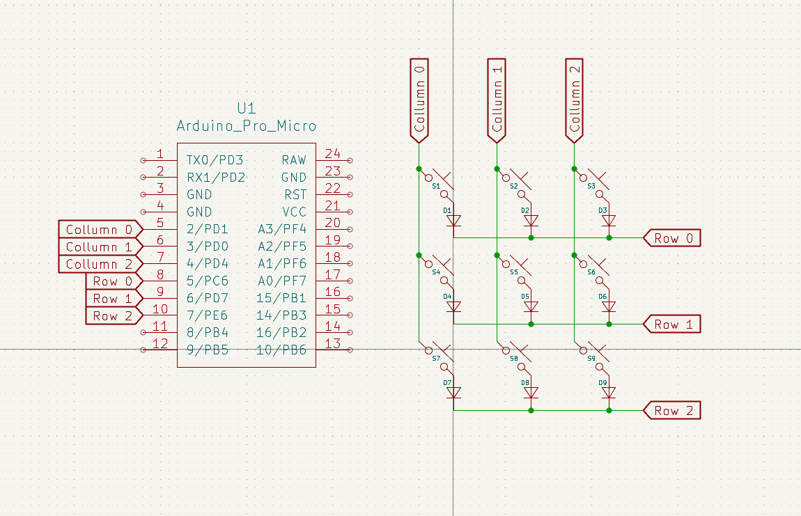
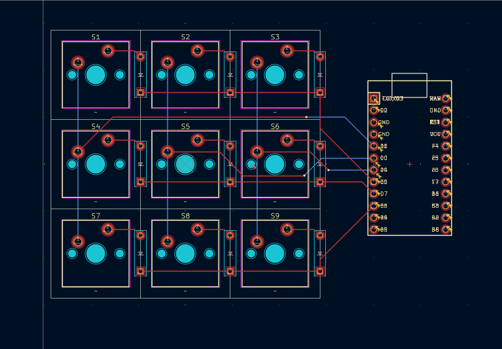

---

## 2 · Getting the tools working, and a PCB redesign
20 Dec 2025 · 5 h 45 min logged

Flavortown's beta finally launched, and I had a lot of hours to log:

1. Fixed Hackatime for Fusion 360, which wasn't compatible with the latest version:
   - Install `requests` and `chardet` inside Fusion 360 itself (in the add-in folder).
   - Rename `main.py` to match the `.manifest` file.
   - Point directly at the path where the pip libraries are installed.
2. Set up Hackatime for KiCad.
3. Redid the schematic and redesigned the PCB, because I had left out GND and a reset button.
4. Learned Fusion 360 and built a practice project along the way.
5. Started my first Fusion sketch.

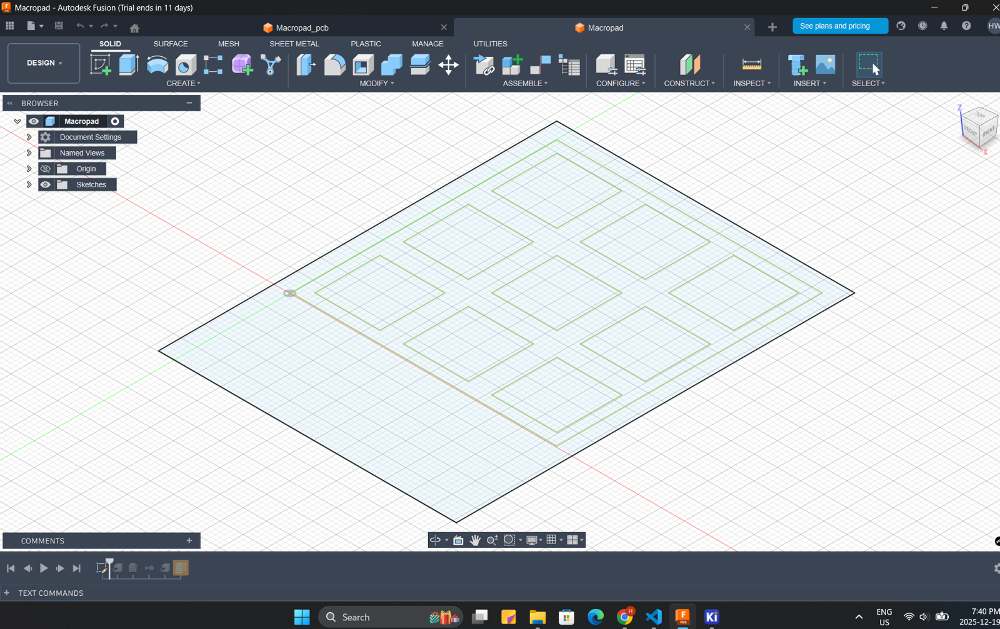

---

## 3 · The case
20 Dec 2025 · 49 min logged

I finally made the case, following along with a tutorial:

- Macropad base
- Macropad top case
- Imported the PCB and key-switch bodies

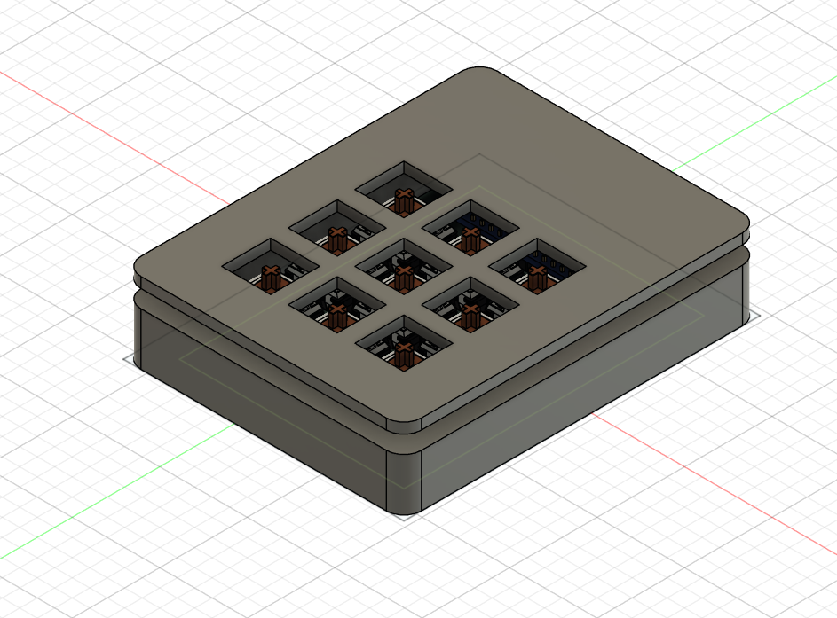

---

## 4 · Power socket and parts order
20 Dec 2025 · 37 min logged

- Added a socket for the Arduino Micro's power supply.
- Purchased the parts: an Arduino Pro Micro and nine Cherry MX key switches.
- Followed a tutorial to order the PCB from JLCPCB.

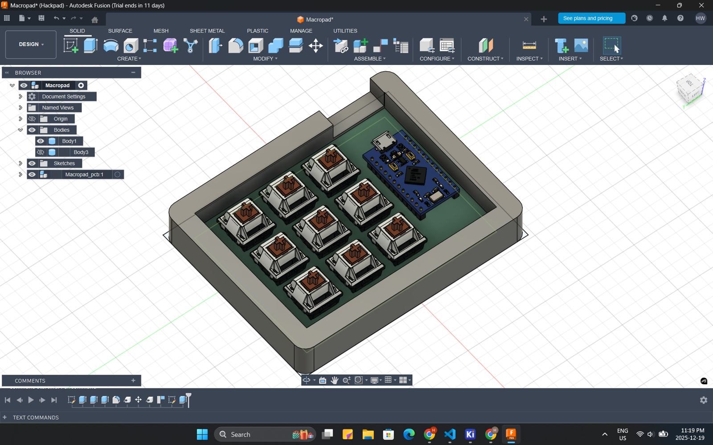

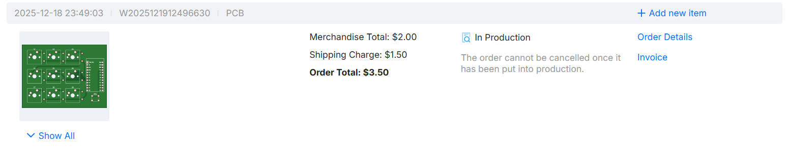

---

## 5 · QMK firmware
20 Dec 2025 · 36 min logged

I installed QMK and added the firmware folder. Hopefully it works when the parts arrive.

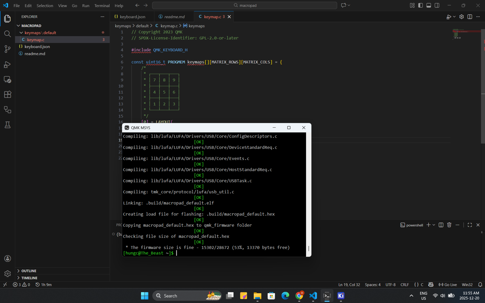

---

## 6 · Printables upload and a firmware fix
20 Dec 2025 · 26 min logged

- Uploaded the demonstration model to Printables.
- Fixed and recompiled the firmware after realising it didn't match the schematic.

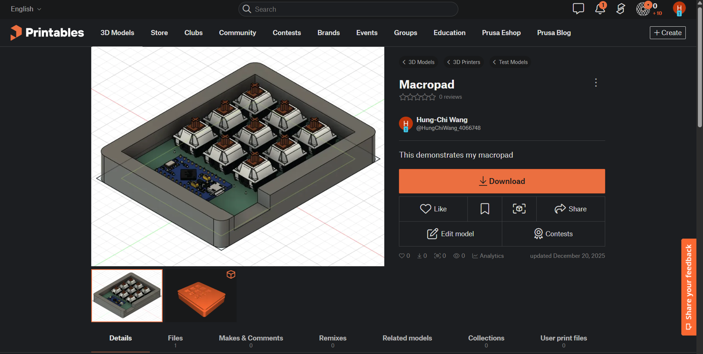

---

## 7 · Published online
28 Dec 2025 · 19 min logged

Updated my demo and published everything online, including the PCB design and schematic on
KiCanvas.

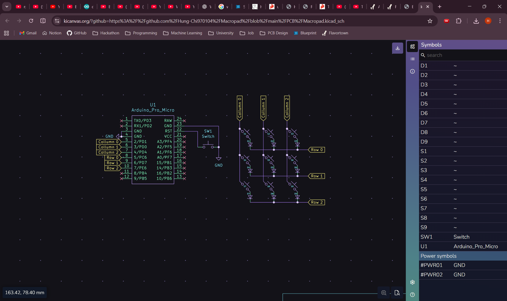
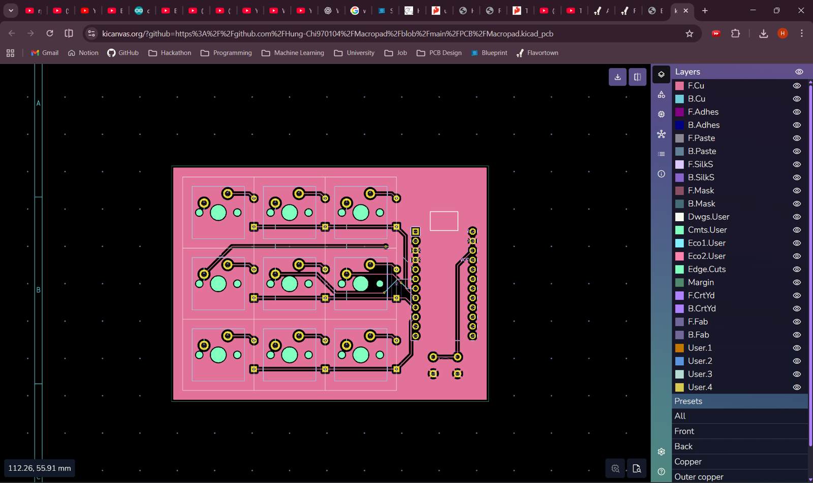

---

## 8 · Soldered, but not working yet
7 Jan 2026 · 1 h 11 min logged

I soldered the keys and the board! It still wasn't working, though. My Arduino Micro seemed to have
issues of its own: it kept disconnecting itself whenever I tried to flash it.

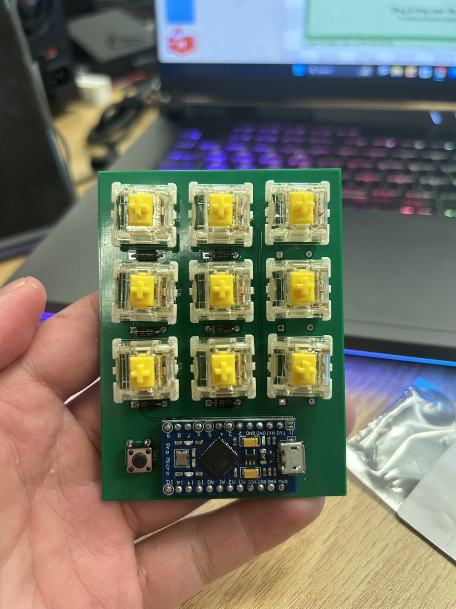
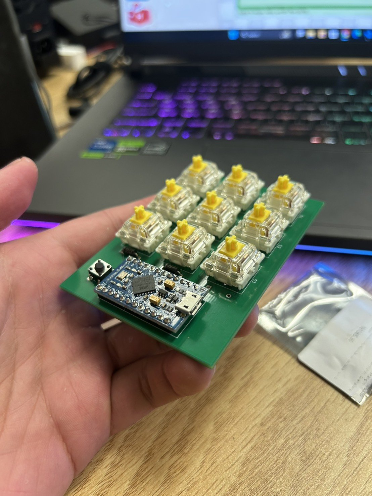

---

## 9 · Tested, documented and rendered
8 Feb 2026 · 2 h 8 min logged

Tested every function, updated the repository and README, and rendered the board.

- Added a proper release page.
- Formatted the README the same way as my other projects.

(I forgot to log this a month ago, which is why these two hours come straight after the previous
entry.)

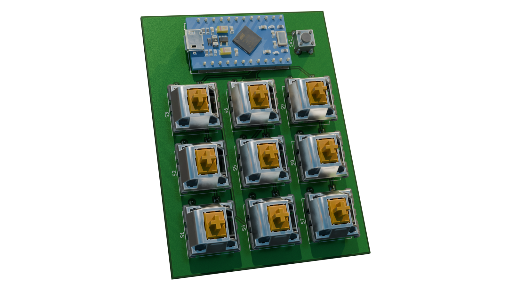

---

## 10 · Video demo
12 Feb 2026 · 15 min logged

Here's the video demo of my working macropad.

▶ [Video (1.8 MB)](media/21831-1.mp4)

---

## 11 · Ready to ship
14 Mar 2026 · 40 min logged

Updated the README and the release; ready to ship under the new system. (I forgot to post a devlog
after this hour of work, which is why it showed up so quickly.)

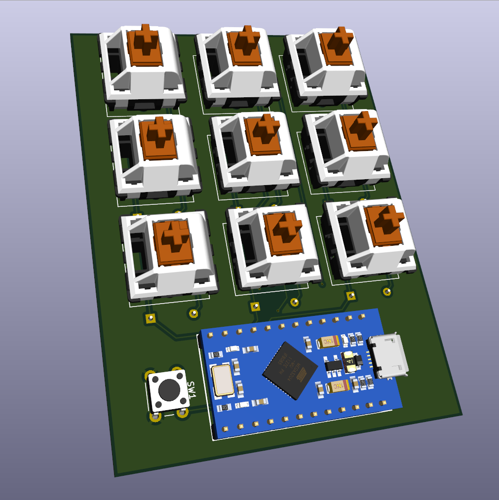

